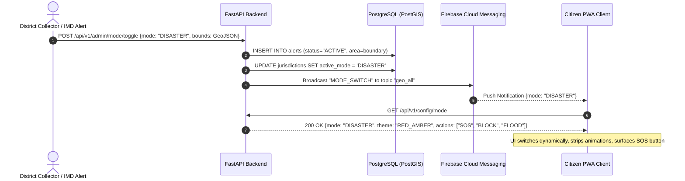
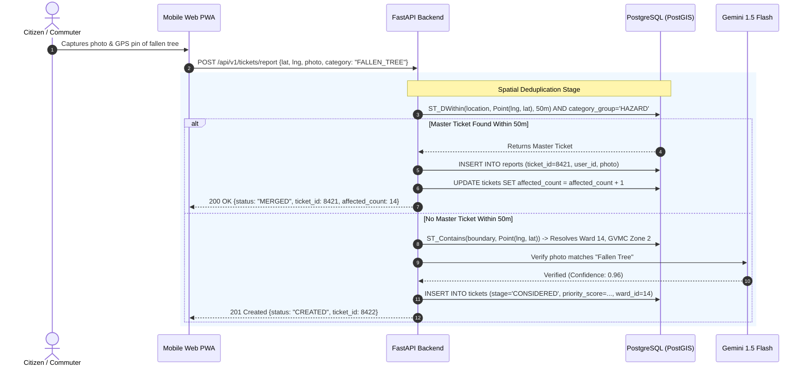
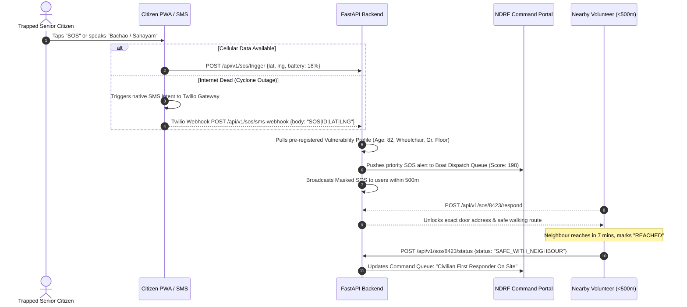
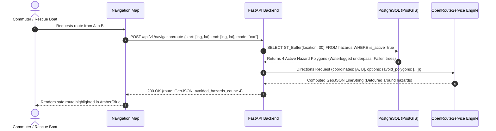

# JanRakshak — Dual-Mode Civic & Disaster Response Platform
### Comprehensive Technical Specification & Hackathon Blueprint
**Target Pilot:** Visakhapatnam (GVMC, APEPDCL, NDRF 10th Battalion, AP State Disaster Management)  
**Document Version:** 1.0.0 (Production Hackathon Spec)  
**Date:** November 2026  

---

## 1. Executive Summary & Pitch Blueprint

### 1.1 One-Line Vision
**JanRakshak** is a unified civic-to-disaster community response platform that serves as a routine municipal maintenance tracker on normal days and autonomously transforms into a high-contrast emergency rescue lifeline during cyclones and floods, ensuring citizens never have to scramble for a disconnected emergency app mid-crisis.

### 1.2 The 30-Second Elevator Pitch
> *"Every monsoon and cyclone, municipal helplines crash under thousands of duplicate calls about the same fallen trees and flooded streets, while trapped senior citizens struggle to get urgent help. We built **JanRakshak**, a dual-mode platform that handles everyday potholes in a calm civic mode and automatically flips into a high-contrast emergency lifeline during disasters. Powered by 50-metre PostGIS spatial clustering, automated municipal ward routing, dynamic hazard-avoiding navigation, and a crowd-assisted Elder SOS network, we cut control-room duplicate noise by 85% and turn nearby neighbours into immediate first responders before rescue boats arrive."*

### 1.3 3-Minute Stage Pitch Script

* **[0:00 – 0:35] The Hook:**  
  *"Imagine Cyclone Michaung hitting Visakhapatnam tonight. A massive banyan tree crashes across the main highway in Madhurawada, snapping an electric line. Within twenty minutes, 200 terrified citizens call the GVMC helpline. While operators are buried logging those 200 duplicate tickets, two streets away, an 82-year-old grandmother with restricted mobility watches floodwaters rise past her porch. Her front door is jammed. She cannot navigate a five-page government portal, and the helpline is permanently busy. Today, routine civic care and disaster rescue live in completely siloed, broken worlds."*

* **[0:35 – 1:15] The Dual-Mode Solution:**  
  *"We built JanRakshak to bridge this exact divide. For 340 normal days a year, the app runs in a calm blue Civic Care Mode. Citizens snap photos of potholes, broken footpaths, or streetlights. Our PostGIS engine matches their GPS coordinates against municipal ward polygons and hands the ticket directly to the assigned GVMC ward engineer. Citizens track progress across a transparent 5-stage lifecycle with mandatory before-and-after photo verification."*

* **[1:15 – 2:00] The Engine: Automated Deduplication & Hazard Avoidance:**  
  *"The moment IMD issues a cyclone warning or the District Collectorate triggers an alert, JanRakshak automatically transforms into high-contrast Red Disaster Mode. Non-essential menus disappear to preserve battery. When 200 people report that fallen tree in Madhurawada, our 50-Metre Spatial Aggregation Engine merges all 200 submissions into one master ticket, appends their photos, and scales its severity score. Meanwhile, our navigation engine converts active roadblocks and deep-water clusters into live exclusion polygons—so when citizens or ambulances request directions, they are automatically detoured around life-threatening hazards."*

* **[2:00 – 2:35] The Heart: Elder SOS & Crowd-Sourced Rescue:**  
  *"Most critically, Disaster Mode activates a massive one-tap and voice-activated SOS button. When our trapped grandmother taps SOS, her pre-saved profile—age, ground floor, heart condition—is instantly dispatched to the NDRF boat command queue. Simultaneously, her SOS is pinned to the top of the public feed for verified neighbours within 500 metres. A neighbour taps 'I Can Help', receives a safe pedestrian route, and reaches her doorway in 7 minutes—saving her life while NDRF boats are still deploying."*

* **[2:35 – 3:00] The Impact & Vision:**  
  *"Because JanRakshak is used year-round for potholes, the city achieves near-100% pre-disaster adoption without spending a single rupee on crisis app awareness campaigns. We slash control-room duplicate chaos by 85%, eliminate manual ward dispatch delays, and build a connected, resilient community. JanRakshak: Civic Care on Normal Days, Citizen Protection in Disasters."*

### 1.4 Judge Q&A Defense Cheat Sheet

| Question from Judge | Technical & Operational Defense |
|:---|:---|
| **"How do you prevent prank complaints and fake SOS signals during a crisis?"** | **Multi-factor verification & physical proof:** 1. Users authenticate via phone OTP. 2. Regular complaints strictly enforce in-app camera capture with device EXIF GPS matching (gallery uploads disabled). 3. Elder SOS requires a pre-verified vulnerability profile linked to Aadhaar/phone. 4. Disaster priority scales with multi-user clustering—an isolated unverified report never monopolizes rescue queues. |
| **"How do you protect vulnerable seniors' privacy on a public map?"** | **Dynamic Proximity Guardrails:** On the public feed, exact flat numbers, door addresses, and phone numbers are strictly masked (showing only "Senior Citizen - Mobility Assistance Needed - Sector 4"). The unmasked contact and exact coordinate unlock *only* for a verified responder who clicks "I Can Help" AND whose live GPS is authenticated to be within 500 metres. |
| **"What happens if mobile cellular data towers go down in a cyclone?"** | **Dual Offline Fallback Protocol:** 1. The PWA caches all UI assets via Service Workers and stores reports in IndexedDB. 2. For SOS, if HTTP requests fail or network status is offline, the app triggers an automatic SMS fallback using Android intent (`sms:GATEWAY?body=SOS|ID|LAT|LNG|VULN|BATTERY`). This hits our cellular Twilio/GSM gateway, injecting the ticket straight into the NDRF dashboard over 2G voice/SMS channels. |
| **"Why not just use Google Maps or Mapbox standard navigation?"** | **Dynamic Hazard Avoidance:** Commercial navigation platforms rely on delayed traffic congestion signals, often routing emergency vehicles directly into freshly submerged streets or fallen wires. JanRakshak injects active hazard clusters directly as `avoid_polygons` into OpenRouteService, creating multi-modal paths (pedestrian vs. high-clearance rescue vehicle vs. car). |
| **"How does this scale beyond Visakhapatnam to other cities?"** | **Zero-Code Jurisdictional Data Model:** Municipal boundaries, ward polygons, department structures, and SLA matrices are completely decoupled from code into PostgreSQL PostGIS tables (`jurisdictions`, `wards`, `routing_rules`). Launching in Vijayawada (VMC) or Hyderabad (GHMC) simply requires uploading their standard GeoJSON boundaries. |

### 1.5 Quantifiable Impact Matrix

```
+-----------------------------------------------------------------------------------+
| Metric                   | Baseline (Current System)  | JanRakshak Target Outcome |
+--------------------------+----------------------------+---------------------------+
| Triage Center Load       | 100+ duplicate calls/spot  | 85% to 90% ticket merge   |
| Departmental Routing     | 4 to 12 hours manual sort  | Instant (<20ms PostGIS)   |
| Senior Citizen SOS SLA   | 2 to 4 hours (NDRF boat)   | 7 to 15 mins (Neighbours) |
| Commuter Hazard Exposure | 0 live road hazard warnings| Dynamic 2 km radius alerts|
| Public Accountability    | Unverified paper closures  | Geo-tagged Before/After   |
+-----------------------------------------------------------------------------------+
```

---

## 2. Problem Statement & Deep Domain Analysis

Coastal cities like Visakhapatnam, Chennai, and Puri face severe cyclonic storms (Hudhud, Michaung, Gulab) and frequent monsoon flash floods. When a disaster strikes, municipal administration collapses due to five distinct operational bottlenecks:

```
  [Routine Civic Life]                              [Severe Disaster / Cyclone]
+----------------------+                          +-------------------------------+
| Smart Vizag / GVMC   |                          | NDRF, SDRF, Fire Services     |
| Potholes, Drains     |  ======================> | Emergency Boat Rescues        |
| 1800-4250-0009 Toll  |       UNBRIDGED GAP      | Uprooted Trees, Live Wires    |
| 6 AM - 8 PM only     |                          | 24x7 War Room Emergency       |
+----------------------+                          +-------------------------------+
           \                                                      /
            \---> [Citizens caught in between with no unified tool] <---/
```

1. **Siloed Systems:** Everyday municipal tools (like Smart Vizag or toll-free helplines) operate strictly for routine complaints. During disasters, the city attempts to broadcast emergency numbers via radio and TV, but panicked citizens flood municipal call centres with distress calls that municipal ward engineers have neither the boats nor equipment to handle.
2. **Ticket Flooding & Duplicate Paralysis:** In Cyclone Michaung, over 30 fallen trees blocked arterial roads. Each obstruction generated hundreds of distinct citizen complaints. Triage staff spent hours answering duplicate calls instead of dispatching chain-saw units.
3. **Inaccessible SOS for Vulnerable Demographics:** When water breaches ground-floor apartments, senior citizens and differently-abled individuals cannot type detailed descriptions or locate ward numbers on a map.
4. **Blind Commuter & Rescue Routing:** Standard navigation algorithms prioritize main roads. During floods, these main roads and underpasses are the first to submerge, leading to vehicle drownings and delayed rescue convoys.
5. **Erosion of Public Trust:** Lack of transparency causes citizens to repeatedly re-register complaints, compounding control-room congestion.

---

## 3. Idea Elaboration & Core Platform Capabilities

### 3.1 Adaptive Dual-Theme Architecture
The application runs as a single installable Progressive Web App (PWA) with server-driven interface switching:

* **Normal Mode (Civic Blue/Emerald Theme):**
  * **Color Palette:** Primary `#1A56DB` (Civic Blue), Accent `#0E9F6E` (Emerald), Background `#F9FAFB`.
  * **Core Focus:** Filing road defects, streetlight failures, garbage spots, and routine drainage issues.
  * **Dashboard:** Public ward progress tracker, standard SLA timers (3–7 days), upvoting feed.
* **Disaster Mode (High-Contrast Red/Amber Theme):**
  * **Trigger:** Automatically invoked when an IMD cyclone alert (Orange/Red alert) is active for the user's geofence, or when manually enabled by the District Collectorate / Municipal Commissioner.
  * **Color Palette:** Primary `#DC2626` (Emergency Red), Warning `#F59E0B` (Amber), Background `#111827` (Dark High-Contrast).
  * **Battery Optimization:** Disables heavy CSS animations, backdrop filters, and auto-refresh intervals to conserve device power during blackouts.
  * **Contextual Action Bar:** Everyday forms are replaced with oversized (minimum 64px tap height) emergency triggers:
    1. **"Road Blocked / Tree Fallen"**
    2. **"Severe Waterlogging"**
    3. **"Elder / Vulnerable SOS"**

### 3.2 Geo-Fenced Municipal & Cross-Agency Auto-Routing
Rather than relying on users to choose their administrative ward from a confusing dropdown, JanRakshak resolves ownership mathematically:
* **PostGIS Boundary Polygon Matching:** When a report is submitted, its coordinates `(lat, lng)` are evaluated against official boundary polygons using `ST_Contains(boundary, ST_SetSRID(ST_Point(lng, lat), 4326))`.
* **Hierarchical Resolution:** Resolves Jurisdiction (GVMC vs. VMC vs. Gram Panchayat) $\rightarrow$ Zone (e.g., Zone 2 Madhurawada) $\rightarrow$ Ward (e.g., Ward 6).
* **Cross-Agency Highway Hand-off:** An integrated spatial line-buffer layer checks if the defect lies on a National Highway (NH-16) or State R&B arterial road. If detected, the ticket automatically bypasses municipal ward staff and routes to the **National Highways Authority of India (NHAI)** or **State Roads & Buildings (R&B)** nodal engineer.

### 3.3 50-Metre Spatial De-duplication & Priority Engine
To eliminate ticket flooding during storms:
1. **Spatial Buffer Detection:** When a new report is filed, the backend searches for active tickets within a 50-metre radius (`ST_DWithin(location, candidate_point, 50)`).
2. **Category & Semantic Compatibility:** If an open ticket exists in the same category group (e.g., `FALLEN_TREE` or `DRAIN_OVERFLOW`), the incoming submission is treated as an endorsement rather than a duplicate.
3. **Master Ticket Aggregation:** The new reporter's photo is appended to the existing master ticket gallery, the `affected_count` counter is incremented by 1, and the reporter is subscribed to push notifications for that ticket.
4. **Dynamic Severity Scoring Algorithm:**
   $$P = W_{\text{cat}} \times M_{\text{mode}} \times \left(1 + \log_2(1 + N)\right) + V$$
   * $W_{\text{cat}}$: Base category weight ($1$ for minor pothole, $10$ for high-voltage wire snap).
   * $M_{\text{mode}}$: Mode multiplier ($1.0$ in Normal Mode, $2.5$ in Disaster Mode).
   * $N$: Number of verified citizen reports merged into this master ticket.
   * $V$: Vulnerability bonus ($+50$ if linked to a trapped elderly or disabled resident).

### 3.4 Senior Citizen & Vulnerable Resident SOS Module
Designed for zero-friction operation during panics:
* **One-Tap & Voice Activation:** A single tap triggers a 5-second cancel countdown. Alternatively, Web Speech API listens for voice commands (*"Help"*, *"Bachao"*, *"Sahayam"* in English, Hindi, and Telugu).
* **Pre-Filled Vulnerability Profile:** During onboarding, seniors or their caregivers register:
  * Age, mobility status (wheelchair, bedridden, walker).
  * Chronic medical conditions (dialysis, insulin-dependent, oxygen requirement).
  * Floor level (e.g., Ground floor flat - high flood drowning risk).
  * Emergency contact name & phone.
* **Offline SMS Fallback:** If mobile internet (4G/5G) is unreachable, the web app triggers an Android/iOS SMS intent directed to our Twilio GSM Gateway.
  * Encoded payload: `SOS|USER_ID|LAT|LNG|VULN_CODE|BATTERY_PCT`
* **Direct NDRF Priority Queue:** SOS alerts skip ward civil engineers and appear instantly on the Disaster Dispatcher dashboard with live battery status and water depth estimates.

### 3.5 Crowd-Sourced Community Rescue Network
NDRF boats take 1 to 3 hours to deploy across waterlogged cities. JanRakshak activates neighbouring citizens as immediate first responders:
* **Public SOS Feed:** Stranded elder tickets appear at the top of the feed within a 500-metre radius with a pulsing red beacon.
* **Proximity Privacy Shield:** Public users see only: *"Elderly Female (82), Ground Floor, Wheelchair Bound, 280m away"*. Exact apartment numbers and contact numbers are cryptographically masked.
* **"I Can Help" Verification:** When a verified nearby resident taps "I Can Help", the backend records their responder ID, streams their distance to the municipal control room, and reveals the exact doorstep navigation route.

### 3.6 Hazard-Aware Navigation Engine
* **Dynamic Roadblock Avoidance:** Every confirmed report of a fallen tree, washed-out bridge, or deep waterlogging generates a buffered polygon (`ST_Buffer(location, 25)`).
* **Dynamic Route Filtering:** Navigation requests query active hazard polygons and inject them into OpenRouteService as `avoid_polygons`.
* **Multi-Modal Routing:**
  * **Pedestrian / Volunteer:** Can navigate narrow alleyways and shallow waters ($<0.3\text{ m}$).
  * **Two-Wheeler / Auto:** Detoured around moderate waterlogging ($>0.2\text{ m}$).
  * **Rescue Truck / Boat:** Prioritized along primary roads with bridge clearance.

### 3.7 Transparent 5-Stage Verification Lifecycle
To eliminate administrative corruption and unverified closures:

```
+------------+      +----------------+      +------------------+      +-------------+      +-----------------+
| Considered | ===> | Assigned Staff | ===> | Work In Progress | ===> |  Completed  | ===> | Verified/Closed |
+------------+      +----------------+      +------------------+      +-------------+      +-----------------+
       |                                                                     ^
       |                                                                     |
       +======================> [ Can't Resolve ] ===========================+
                           (Public Justification &
                            Escalated to Collector)
```

1. **Stage 1 — Considered:** PostGIS validates coordinates, merges duplicates within 50m, and assigns a master ticket ID visible on the public map.
2. **Stage 2 — Assigned Staff:** System routes ticket to specific ward engineer or NDRF captain. Public sees officer name, department, and SLA target.
3. **Stage 3 — Work In Progress:** Field worker arrives on site and checks in via GPS (must be within 100m of ticket pin) and uploads a mandatory **"Before Photo"**.
4. **Stage 4 — Completed:** Field worker uploads a mandatory geo-tagged **"After Photo"**.
5. **Stage 5 — Citizen Verification:** All citizens who reported or upvoted the master ticket receive a notification: *"Has this been fixed?"*. If $>50\%$ vote "Not Fixed" within 48 hours, the ticket automatically re-opens.
6. **Exception — Can't Resolve:** If work requires a major budget tender or highway clearance, the officer must publish an official written justification. The ticket is escalated to the Municipal Commissioner's dashboard.

---

## 4. User Roles & Permission Matrix

The platform implements Role-Based Access Control (RBAC) across 7 distinct personas:

| Role Code | User Persona | Primary Interface | Allowed Capabilities |
|:---|:---|:---|:---|
| `CITIZEN` | General Resident | Citizen PWA | Report civic issues, upvote master tickets, view public map, verify fixes. |
| `VULNERABLE` | Senior / Differently Abled | Citizen PWA (High Contrast) | All citizen features + one-tap SOS + voice distress trigger. |
| `RESPONDER` | Verified Community Volunteer | Volunteer Console | View nearby SOS alerts (<500m), tap "I Can Help", unlock masked addresses. |
| `WARD_OFFICER` | GVMC Assistant Engineer | Ward Admin Portal | View assigned ward tickets, reassign field crews, log "Can't Resolve" justifications. |
| `FIELD_WORKER` | Sanitation / Road Crew | Mobile Field App | GPS check-in on site, upload before/after photos, transition tickets to Completed. |
| `DISPATCHER` | NDRF / Fire Control Room | Emergency Command Map | View active SOS queue, assign rescue boats/ambulances, broadcast hazard alerts. |
| `SUPER_ADMIN` | District Collector / Municipal Comm. | Executive Dashboard | Toggle Disaster Mode across wards, upload GeoJSON boundaries, audit SLA breaches. |

---

## 5. End-to-End System Architecture

```
+----------------------------------------------------------------------------------------------------+
|                                         CLIENT SURFACES                                            |
|  +---------------------------+  +---------------------------+  +--------------------------------+  |
|  | Citizen & Vulnerable PWA  |  | Community Responder View  |  | Official Field & Admin Portal  |  |
|  | (React + Vite + Tailwind) |  | (Leaflet/MapLibre + Geofire) (React + TanStack Table + Charts) |  |
|  +---------------------------+  +---------------------------+  +--------------------------------+  |
+----------------------------------------------------------------------------------------------------+
                                      |                       ^
                      HTTPS / REST    |                       | WebSocket Live Events
                                      v                       |
+----------------------------------------------------------------------------------------------------+
|                                    API GATEWAY & BACKEND SERVICE                                   |
|                                       (Python FastAPI 0.110+)                                      |
|                                                                                                    |
|  +------------------+  +------------------+  +------------------+  +----------------------------+  |
|  | Auth & RBAC      |  | Spatial De-dup   |  | Ward Auto-Route  |  | Disaster Mode Controller   |  |
|  | (Firebase JWT)   |  | (50m Radius PostGIS)| (ST_Contains Poly) | (IMD Ingest & Manual Lock) |  |
|  +------------------+  +------------------+  +------------------+  +----------------------------+  |
|  +------------------+  +------------------+  +------------------+  +----------------------------+  |
|  | Elder SOS Engine |  | Hazard Router    |  | Ticket Lifecycle |  | Notification Dispatcher    |  |
|  | (Queue & SMS)    |  | (Avoid Polygons) |  | (5-Stage State)  |  | (FCM + Twilio Webhooks)    |  |
|  +------------------+  +------------------+  +------------------+  +----------------------------+  |
+----------------------------------------------------------------------------------------------------+
                   |                            |                            |
                   v                            v                            v
+-------------------------------+  +--------------------------+  +-----------------------------------+
|      DATABASE & STORAGE       |  |     AI & SPATIAL ENGINE  |  |     THIRD-PARTY INTEGRATIONS      |
| PostgreSQL 16 + PostGIS 3.4   |  | Google Gemini 1.5 Flash  |  | Firebase Cloud Messaging (FCM)    |
| (Geo-Spatial queries, GiST)   |  | (Image verification &    |  | Twilio Programmable SMS Gateway   |
| Supabase Storage (S3 API)     |  |  SOS summary generation) |  | OpenRouteService (Avoid routing)  |
| (Geotagged photos & evidence) |  |                          |  | OpenStreetMap Tile Servers (OSM)  |
+-------------------------------+  +--------------------------+  +-----------------------------------+
```

---

## 6. Detailed Application Workflows

### 6.1 Workflow A: Disaster Mode Activation Flow



### 6.2 Workflow B: Citizen Report Intake & Spatial Deduplication



### 6.3 Workflow C: Elder SOS & Crowd-Sourced Rescue Chain



### 6.4 Workflow D: Hazard-Avoiding Navigation



---

## 7. Recommended Production Tech Stack

| Layer | Technology | Selection Rationale | Hackathon Optimization |
|:---|:---|:---|:---|
| **Frontend Framework** | **React 18 + Vite + TypeScript** | Blazing fast build, lightweight PWA support, typed data flow. | Fast single-repo workflow with zero compilation lag. |
| **Styling & Theming** | **Tailwind CSS + CSS Variables** | Instant theme swapping between `Normal` (Blue) and `Disaster` (Red). | Uses `data-mode="normal"` on `<html>` tag. |
| **Map Rendering** | **MapLibre GL JS** | Open-source, hardware-accelerated vector mapping, no Mapbox API token constraints. | Works natively with OpenStreetMap raster & vector tiles. |
| **Backend API** | **Python FastAPI 0.110+** | High-performance asynchronous REST & WebSocket framework with auto Swagger UI. | Interactive docs at `/docs` out of the box for judges. |
| **Spatial Database** | **PostgreSQL 16 + PostGIS 3.4** | Industry-standard spatial clustering (`ST_DWithin`) and polygon contains (`ST_Contains`). | Free managed instance on Supabase or Neon. |
| **Object Storage** | **Supabase Storage (S3 Compatible)** | Secure, pre-signed upload URLs for geotagged before-and-after photo proof. | Eliminates server-side multipart file handling bottlenecks. |
| **Authentication** | **Firebase Auth (Phone OTP)** | Native phone number OTP verification for citizens; JWT validated in FastAPI. | Free tier supports 10,000 phone authentications. |
| **Push Notifications** | **Firebase Cloud Messaging (FCM)** | Topic-based broadcasting (`geo_ward_14`, `geo_disaster_all`). | Instant push delivery to locked mobile screens. |
| **Routing Engine** | **OpenRouteService (ORS) API** | Supports custom multi-polygon exclusion (`avoid_polygons`) across vehicle profiles. | Generous free tier of 2,000 directions requests/day. |
| **Multimodal AI** | **Google Gemini 1.5 Flash** | Rapid zero-shot image validation (confirms pothole vs. fallen tree) & SOS summary. | High speed, low latency, free tier via Google AI Studio. |
| **Telephony / SMS** | **Twilio Programmable SMS** | Inbound webhook for 2G network offline SMS emergency rescue fallback. | Simple webhook endpoint converts SMS to database ticket. |
| **Deployment / CI** | **Vercel (PWA) + Render / Cloud Run (API)** | Auto-deploy on git push, automatic SSL, generous free tiers. | Zero operational overhead during hackathon presentation. |

---

## 8. Frontend Architecture & UI Specifications

### 8.1 Folder Structure
```
frontend/
├── public/
│   ├── manifest.json              # PWA manifest with disaster shortcuts
│   ├── sw.js                      # Service Worker for offline tile/data caching
│   └── icons/                     # High-contrast app icons
├── src/
│   ├── api/                       # Axios client & typed endpoint SDKs
│   ├── components/
│   │   ├── common/                # Buttons, Modals, CameraCapture, Badges
│   │   ├── navigation/            # RouteMap, HazardLayer, AvoidanceWarning
│   │   ├── sos/                   # SosButton, VoiceListener, ProximityCard
│   │   ├── tickets/               # TicketFeed, TicketCard, VerificationVote
│   │   └── admin/                 # ModeToggleSwitch, WardBoundaryManager
│   ├── context/
│   │   ├── AuthContext.tsx        # Firebase user session & role
│   │   └── ThemeModeContext.tsx   # Server-driven Normal/Disaster mode state
│   ├── hooks/
│   │   ├── useGeolocation.ts      # Continuous GPS watch with accuracy filter
│   │   ├── useOfflineSync.ts      # IndexedDB queue for failed submissions
│   │   └── useSpeechSOS.ts        # Web Speech API recognition listener
│   ├── pages/
│   │   ├── CitizenHome.tsx        # Dynamic dashboard based on active mode
│   │   ├── ReportIssue.tsx        # Mandatory camera capture & geo-tagging
│   │   ├── TicketDetail.tsx       # 5-stage timeline & before/after comparison
│   │   ├── PublicWardMap.tsx      # Interactive choropleth & cluster map
│   │   ├── VolunteerFeed.tsx      # Filtered SOS feed within 500m
│   │   └── AdminDashboard.tsx     # Dispatcher queues & GIS analytics
│   ├── styles/
│   │   └── theme.css              # CSS variable bindings for dual themes
│   ├── App.tsx
│   └── main.tsx
```

### 8.2 Dynamic CSS Theming Strategy
Theme switching is managed entirely via the `data-mode` HTML attribute driven by the backend mode response:

```css
/* theme.css */
:root[data-mode="normal"] {
  --bg-primary: #F9FAFB;
  --bg-surface: #FFFFFF;
  --text-main: #111827;
  --text-muted: #6B7280;
  --color-primary: #1A56DB;    /* Civic Blue */
  --color-accent: #0E9F6E;     /* Emerald Green */
  --color-warning: #D97706;
  --color-border: #E5E7EB;
  --sos-display: none;         /* SOS hidden in normal mode */
  --civic-feed-display: block;
}

:root[data-mode="disaster"] {
  --bg-primary: #0F172A;       /* Ultra-Dark Slate for battery saving */
  --bg-surface: #1E293B;
  --text-main: #F8FAFC;
  --text-muted: #94A3B8;
  --color-primary: #DC2626;    /* Emergency Red */
  --color-accent: #F59E0B;     /* Alert Amber */
  --color-warning: #EF4444;
  --color-border: #334155;
  --sos-display: flex;         /* SOS full-width banner visible */
  --civic-feed-display: none;  /* Routine pothole feed suppressed */
}
```

---

## 9. Backend Architecture & Modular Services

The backend is built around clean architectural patterns where routers handle HTTP serialization and business logic is isolated in stateless service layers:

```
backend/
├── app/
│   ├── api/v1/                    # API route controllers
│   │   ├── auth.py                # Firebase JWT verification & user syncing
│   │   ├── config.py              # Server-driven UI mode & feature flags
│   │   ├── tickets.py             # Citizen report intake & stage lifecycle
│   │   ├── sos.py                 # Emergency triggers & volunteer handshakes
│   │   ├── navigation.py          # Avoidance pathfinding with OpenRouteService
│   │   ├── hazards.py             # Hazard polygon generation & queries
│   │   ├── admin.py               # Boundary uploads & disaster mode switch
│   │   └── websocket.py           # Real-time incident & map event bus
│   ├── core/
│   │   ├── config.py              # Pydantic environment settings
│   │   ├── database.py            # SQLAlchemy 2.0 async engine session
│   │   └── security.py            # RBAC dependency guards
│   ├── models/                    # SQLAlchemy & GeoAlchemy2 ORM definitions
│   │   ├── base.py
│   │   ├── user.py
│   │   ├── ticket.py
│   │   ├── jurisdiction.py
│   │   ├── hazard.py
│   │   └── sos.py
│   ├── schemas/                   # Pydantic v2 validation contracts
│   │   ├── ticket.py
│   │   ├── sos.py
│   │   ├── navigation.py
│   │   └── admin.py
│   ├── services/                  # Pure domain logic
│   │   ├── dedup_engine.py        # PostGIS 50m spatial cluster search
│   │   ├── routing_engine.py      # ST_Contains polygon & highway resolver
│   │   ├── priority_calculator.py # Mathematical severity weighting
│   │   ├── gemini_service.py      # Multimodal photo content validation
│   │   ├── ors_service.py         # OpenRouteService wrapper with avoid_polygons
│   │   └── notification_hub.py    # FCM & Twilio webhook publisher
│   └── main.py                    # App entrypoint, middleware, CORS
├── migrations/                    # Alembic spatial migration scripts
├── seeds/                         # Visakhapatnam GeoJSON wards & sample data
├── Dockerfile
└── requirements.txt
```

---

## 10. Database Models & Relational Architecture (PostGIS)

The relational schema centers around the `tickets` master table, which serves as the hub for reports, evidence photos, lifecycle events, and emergency metadata.

### 10.1 Entity-Relationship Overview

```
 [jurisdictions] 1 ------- N [wards]
                               |
                               | 1
                               |
                               | N
                            [tickets] 1 ------- 1 [hazards]
                           /    |    \
                          /     |     \
                       1 /    1 |      \ 1
                        /       |       \
                       N        N        N
                  [reports]  [media]  [ticket_events]
                     |
                     | N
                     |
                     | 1
                  [users] 1 ------- 1 [vulnerability_profiles]
                     |
                     | 1
                     |
                     | N
               [sos_requests] 1 ------- N [sos_responders]
```

### 10.2 Table Specifications (Complete 21-Table Schema)

#### 1. `users` (Core Identity & RBAC)
```sql
CREATE TABLE users (
    id UUID PRIMARY KEY DEFAULT gen_random_uuid(),
    firebase_uid VARCHAR(128) UNIQUE NOT NULL,
    phone VARCHAR(15) UNIQUE NOT NULL,
    full_name VARCHAR(100),
    role VARCHAR(30) DEFAULT 'CITIZEN' CHECK (role IN ('CITIZEN', 'VULNERABLE', 'RESPONDER', 'WARD_OFFICER', 'FIELD_WORKER', 'DISPATCHER', 'SUPER_ADMIN')),
    preferred_language VARCHAR(5) DEFAULT 'te' CHECK (preferred_language IN ('te', 'en', 'hi')),
    fcm_token TEXT,
    last_location GEOGRAPHY(Point, 4326),
    last_location_at TIMESTAMPTZ,
    is_verified BOOLEAN DEFAULT FALSE,
    created_at TIMESTAMPTZ DEFAULT NOW(),
    updated_at TIMESTAMPTZ DEFAULT NOW()
);
CREATE INDEX idx_users_last_location ON users USING GIST (last_location);
```

#### 2. `vulnerability_profiles` (Elder & Accessibility Metadata)
```sql
CREATE TABLE vulnerability_profiles (
    user_id UUID PRIMARY KEY REFERENCES users(id) ON DELETE CASCADE,
    age INT NOT NULL CHECK (age >= 0),
    mobility_status VARCHAR(50) NOT NULL, -- 'WHEELCHAIR', 'BEDRIDDEN', 'WALKER', 'INDEPENDENT'
    medical_notes TEXT,                   -- 'Requires oxygen', 'Dialysis patient'
    floor_level INT DEFAULT 0,            -- 0 = Ground floor (high flood risk)
    has_power_backup BOOLEAN DEFAULT FALSE,
    trusted_contact_name VARCHAR(100),
    trusted_contact_phone VARCHAR(15),
    consent_timestamp TIMESTAMPTZ DEFAULT NOW()
);
```

#### 3. `jurisdictions` (Municipalities & Authorities)
```sql
CREATE TABLE jurisdictions (
    id SERIAL PRIMARY KEY,
    code VARCHAR(20) UNIQUE NOT NULL,    -- 'GVMC', 'VMC', 'GHMC', 'NHAI_AP'
    name VARCHAR(150) NOT NULL,
    type VARCHAR(30) NOT NULL,            -- 'MUNICIPAL_CORP', 'HIGHWAY_AUTHORITY', 'GRAM_PANCHAYAT'
    boundary GEOMETRY(MultiPolygon, 4326) NOT NULL,
    active_mode VARCHAR(20) DEFAULT 'NORMAL' CHECK (active_mode IN ('NORMAL', 'DISASTER')),
    created_at TIMESTAMPTZ DEFAULT NOW()
);
CREATE INDEX idx_jurisdictions_boundary ON jurisdictions USING GIST (boundary);
```

#### 4. `wards` (Administrative Sub-units)
```sql
CREATE TABLE wards (
    id SERIAL PRIMARY KEY,
    jurisdiction_id INT REFERENCES jurisdictions(id) ON DELETE CASCADE,
    ward_number INT NOT NULL,
    zone_name VARCHAR(100) NOT NULL,      -- 'Zone 2 Madhurawada'
    ward_engineer_name VARCHAR(100),
    ward_engineer_phone VARCHAR(15),
    boundary GEOMETRY(MultiPolygon, 4326) NOT NULL,
    UNIQUE (jurisdiction_id, ward_number)
);
CREATE INDEX idx_wards_boundary ON wards USING GIST (boundary);
```

#### 5. `agencies` (Department Routing Entities)
```sql
CREATE TABLE agencies (
    id SERIAL PRIMARY KEY,
    code VARCHAR(50) UNIQUE NOT NULL,    -- 'GVMC_CIVIL', 'GVMC_DRAINAGE', 'APEPDCL', 'NDRF_10', 'FIRE_SERVICES'
    name VARCHAR(150) NOT NULL,
    department_type VARCHAR(50) NOT NULL, -- 'CIVIL', 'ELECTRICAL', 'DISASTER_RESCUE', 'HIGHWAY'
    emergency_helpline VARCHAR(20)
);
```

#### 6. `categories` (Issue Classification Matrix)
```sql
CREATE TABLE categories (
    id SERIAL PRIMARY KEY,
    code VARCHAR(50) UNIQUE NOT NULL,    -- 'POTHOLE', 'FALLEN_TREE', 'WATERLOGGING_SEVERE', 'LIVE_WIRE', 'ELDER_SOS'
    name VARCHAR(100) NOT NULL,
    group_code VARCHAR(30) NOT NULL,     -- 'ROAD', 'ELECTRICAL', 'DRAINAGE', 'LIFE_SAFETY'
    base_weight INT DEFAULT 1 CHECK (base_weight BETWEEN 1 AND 10),
    is_hazard BOOLEAN DEFAULT FALSE,
    disaster_only BOOLEAN DEFAULT FALSE,
    default_agency_id INT REFERENCES agencies(id)
);
```

#### 7. `sla_policies` (Resolution SLA Targets)
```sql
CREATE TABLE sla_policies (
    id SERIAL PRIMARY KEY,
    category_id INT REFERENCES categories(id) ON DELETE CASCADE,
    operating_mode VARCHAR(20) NOT NULL CHECK (operating_mode IN ('NORMAL', 'DISASTER')),
    target_resolution_hours INT NOT NULL,
    escalation_tier_hours INT NOT NULL,
    UNIQUE (category_id, operating_mode)
);
```

#### 8. `routing_rules` (Cross-Agency Dispatch Matrix)
```sql
CREATE TABLE routing_rules (
    id SERIAL PRIMARY KEY,
    jurisdiction_id INT REFERENCES jurisdictions(id),
    category_id INT REFERENCES categories(id),
    is_national_highway BOOLEAN DEFAULT FALSE,
    assigned_agency_id INT REFERENCES agencies(id),
    priority_level INT DEFAULT 1
);
```

#### 9. `tickets` (Master Aggregated Civic/Disaster Tickets)
```sql
CREATE TABLE tickets (
    id UUID PRIMARY KEY DEFAULT gen_random_uuid(),
    ticket_number VARCHAR(32) UNIQUE NOT NULL, -- e.g., 'GVMC-2026-08421'
    category_id INT REFERENCES categories(id),
    category_group VARCHAR(30) NOT NULL,
    location GEOGRAPHY(Point, 4326) NOT NULL,
    ward_id INT REFERENCES wards(id),
    assigned_agency_id INT REFERENCES agencies(id),
    assigned_officer_id UUID REFERENCES users(id),
    stage VARCHAR(30) DEFAULT 'CONSIDERED' CHECK (stage IN ('CONSIDERED', 'ASSIGNED_STAFF', 'WORK_IN_PROGRESS', 'COMPLETED', 'CANT_RESOLVE')),
    operating_mode VARCHAR(20) DEFAULT 'NORMAL' CHECK (operating_mode IN ('NORMAL', 'DISASTER')),
    priority_score FLOAT DEFAULT 1.0,
    affected_count INT DEFAULT 1,
    is_hazard BOOLEAN DEFAULT FALSE,
    sla_due_at TIMESTAMPTZ,
    cant_resolve_reason TEXT,
    created_at TIMESTAMPTZ DEFAULT NOW(),
    updated_at TIMESTAMPTZ DEFAULT NOW(),
    closed_at TIMESTAMPTZ
);
CREATE INDEX idx_tickets_location ON tickets USING GIST (location);
CREATE INDEX idx_tickets_stage_priority ON tickets (stage, priority_score DESC);
CREATE INDEX idx_tickets_ward ON tickets (ward_id, stage);
```

#### 10. `reports` (Individual Citizen Submissions Clustered into Tickets)
```sql
CREATE TABLE reports (
    id UUID PRIMARY KEY DEFAULT gen_random_uuid(),
    ticket_id UUID REFERENCES tickets(id) ON DELETE CASCADE,
    user_id UUID REFERENCES users(id),
    client_submission_id VARCHAR(64) UNIQUE, -- Idempotency token for offline retries
    description TEXT,
    reported_location GEOGRAPHY(Point, 4326) NOT NULL,
    gps_accuracy_meters FLOAT,
    created_at TIMESTAMPTZ DEFAULT NOW()
);
CREATE INDEX idx_reports_ticket_id ON reports (ticket_id);
```

#### 11. `media` (Geotagged Photo Evidence)
```sql
CREATE TABLE media (
    id UUID PRIMARY KEY DEFAULT gen_random_uuid(),
    ticket_id UUID REFERENCES tickets(id) ON DELETE CASCADE,
    report_id UUID REFERENCES reports(id) ON DELETE SET NULL,
    uploaded_by UUID REFERENCES users(id),
    purpose VARCHAR(20) NOT NULL CHECK (purpose IN ('REPORT', 'BEFORE_WORK', 'AFTER_WORK')),
    storage_path TEXT NOT NULL,
    captured_location GEOGRAPHY(Point, 4326),
    created_at TIMESTAMPTZ DEFAULT NOW()
);
CREATE INDEX idx_media_ticket ON media (ticket_id, purpose);
```

#### 12. `ticket_events` (Immutable Audit Trail & Public Timeline)
```sql
CREATE TABLE ticket_events (
    id BIGSERIAL PRIMARY KEY,
    ticket_id UUID REFERENCES tickets(id) ON DELETE CASCADE,
    actor_id UUID REFERENCES users(id),
    event_type VARCHAR(50) NOT NULL, -- 'CREATED', 'MERGED', 'ASSIGNED', 'CHECKIN_BEFORE', 'COMPLETED_AFTER', 'REOPENED'
    from_stage VARCHAR(30),
    to_stage VARCHAR(30),
    notes TEXT,
    metadata JSONB,
    created_at TIMESTAMPTZ DEFAULT NOW()
);
CREATE INDEX idx_ticket_events ON ticket_events (ticket_id, created_at ASC);
```

#### 13. `ticket_votes` (Upvotes & Citizen Fix Verification)
```sql
CREATE TABLE ticket_votes (
    ticket_id UUID REFERENCES tickets(id) ON DELETE CASCADE,
    user_id UUID REFERENCES users(id) ON DELETE CASCADE,
    vote_type VARCHAR(20) NOT NULL CHECK (vote_type IN ('AFFECTED_ME', 'FIX_VERIFIED', 'FIX_REJECTED')),
    created_at TIMESTAMPTZ DEFAULT NOW(),
    PRIMARY KEY (ticket_id, user_id, vote_type)
);
```

#### 14. `hazards` (Navigation Exclusion Polygons)
```sql
CREATE TABLE hazards (
    id SERIAL PRIMARY KEY,
    ticket_id UUID UNIQUE REFERENCES tickets(id) ON DELETE CASCADE,
    polygon GEOMETRY(Polygon, 4326) NOT NULL, -- ST_Buffer around point
    severity VARCHAR(30) NOT NULL CHECK (severity IN ('PARTIAL_BLOCK', 'TOTAL_BLOCK', 'DEEP_WATER', 'ELECTRICAL_HAZARD')),
    blocks_pedestrians BOOLEAN DEFAULT FALSE,
    blocks_two_wheelers BOOLEAN DEFAULT TRUE,
    blocks_four_wheelers BOOLEAN DEFAULT TRUE,
    is_active BOOLEAN DEFAULT TRUE,
    expires_at TIMESTAMPTZ,
    created_at TIMESTAMPTZ DEFAULT NOW()
);
CREATE INDEX idx_hazards_polygon ON hazards USING GIST (polygon);
CREATE INDEX idx_hazards_active ON hazards (is_active);
```

#### 15. `alerts` (IMD Weather & Disaster Geo-Broadcasts)
```sql
CREATE TABLE alerts (
    id SERIAL PRIMARY KEY,
    external_source VARCHAR(50),        -- 'IMD_HYDERABAD', 'SDMA_AP', 'COLLECTOR_MANUAL'
    alert_level VARCHAR(20) NOT NULL CHECK (alert_level IN ('YELLOW', 'ORANGE', 'RED')),
    hazard_type VARCHAR(50) NOT NULL,    -- 'CYCLONE_WARNING', 'FLASH_FLOOD', 'STORM_SURGE'
    headline VARCHAR(200) NOT NULL,
    description TEXT,
    affected_area GEOMETRY(MultiPolygon, 4326) NOT NULL,
    starts_at TIMESTAMPTZ NOT NULL,
    ends_at TIMESTAMPTZ NOT NULL,
    is_active BOOLEAN DEFAULT TRUE,
    created_at TIMESTAMPTZ DEFAULT NOW()
);
CREATE INDEX idx_alerts_affected_area ON alerts USING GIST (affected_area);
```

#### 16. `sos_requests` (Life-Safety SOS Incidents)
```sql
CREATE TABLE sos_requests (
    id UUID PRIMARY KEY DEFAULT gen_random_uuid(),
    ticket_id UUID UNIQUE REFERENCES tickets(id) ON DELETE CASCADE,
    user_id UUID REFERENCES users(id),
    channel VARCHAR(20) DEFAULT 'APP' CHECK (channel IN ('APP', 'VOICE_TRIGGER', 'OFFLINE_SMS')),
    vulnerability_snapshot JSONB NOT NULL, -- Frozen copy of medical/mobility status at SOS time
    battery_percentage INT CHECK (battery_percentage BETWEEN 0 AND 100),
    live_location GEOGRAPHY(Point, 4326) NOT NULL,
    assigned_rescue_team_id INT,           -- FK to rescue_teams
    status VARCHAR(30) DEFAULT 'DISPATCHED' CHECK (status IN ('DISPATCHED', 'RESPONDER_EN_ROUTE', 'REACHED', 'EVACUATED', 'CANCELLED')),
    created_at TIMESTAMPTZ DEFAULT NOW(),
    updated_at TIMESTAMPTZ DEFAULT NOW()
);
CREATE INDEX idx_sos_location ON sos_requests USING GIST (live_location);
CREATE INDEX idx_sos_status ON sos_requests (status);
```

#### 17. `sos_responders` (Community Volunteers Linked to SOS)
```sql
CREATE TABLE sos_responders (
    id UUID PRIMARY KEY DEFAULT gen_random_uuid(),
    sos_request_id UUID REFERENCES sos_requests(id) ON DELETE CASCADE,
    responder_id UUID REFERENCES users(id),
    status VARCHAR(30) DEFAULT 'EN_ROUTE' CHECK (status IN ('EN_ROUTE', 'ON_SITE', 'COMPLETED', 'ABORTED')),
    distance_meters_at_acceptance FLOAT,
    accepted_at TIMESTAMPTZ DEFAULT NOW(),
    arrived_at TIMESTAMPTZ,
    UNIQUE (sos_request_id, responder_id)
);
```

#### 18. `rescue_teams` (Official NDRF, SDRF & Fire Service Squads)
```sql
CREATE TABLE rescue_teams (
    id SERIAL PRIMARY KEY,
    agency_id INT REFERENCES agencies(id),
    team_code VARCHAR(50) UNIQUE NOT NULL, -- 'NDRF_BOAT_04', 'VIZAG_FIRE_QRT_1'
    leader_name VARCHAR(100),
    contact_phone VARCHAR(15),
    vehicle_type VARCHAR(50),              -- 'INFLATABLE_BOAT', 'RESCUE_TRUCK', 'AMBULANCE'
    current_location GEOGRAPHY(Point, 4326),
    is_available BOOLEAN DEFAULT TRUE,
    updated_at TIMESTAMPTZ DEFAULT NOW()
);
```

#### 19. `staff_scopes` (Ward Assignment Permissions)
```sql
CREATE TABLE staff_scopes (
    id SERIAL PRIMARY KEY,
    user_id UUID REFERENCES users(id) ON DELETE CASCADE,
    agency_id INT REFERENCES agencies(id),
    ward_id INT REFERENCES wards(id),     -- NULL means zonal/citywide coverage
    role_title VARCHAR(100)               -- 'Assistant Engineer (Civil)', 'Sanitation Inspector'
);
```

#### 20. `notifications` (Push & SMS Broadcast Ledger)
```sql
CREATE TABLE notifications (
    id UUID PRIMARY KEY DEFAULT gen_random_uuid(),
    user_id UUID REFERENCES users(id) ON DELETE CASCADE,
    title VARCHAR(150) NOT NULL,
    body TEXT NOT NULL,
    channel VARCHAR(20) NOT NULL CHECK (channel IN ('FCM_PUSH', 'SMS', 'IN_APP')),
    delivery_status VARCHAR(20) DEFAULT 'SENT',
    sent_at TIMESTAMPTZ DEFAULT NOW()
);
CREATE INDEX idx_notifications_user ON notifications (user_id, sent_at DESC);
```

#### 21. `offline_sync_log` (Edge Reliability & Duplication Prevention)
```sql
CREATE TABLE offline_sync_log (
    id UUID PRIMARY KEY DEFAULT gen_random_uuid(),
    client_device_id VARCHAR(100) NOT NULL,
    client_submission_id VARCHAR(64) UNIQUE NOT NULL,
    synced_at TIMESTAMPTZ DEFAULT NOW(),
    processed_status VARCHAR(20) NOT NULL
);
```

---

## 11. Complete REST API Endpoints Specification

All endpoints are prefixed with `/api/v1` and return standardized JSON envelopes.

### 11.1 Configuration & Mode Subsystem

#### `GET /api/v1/config/mode`
* **Responsibility:** Returns the active operating mode (Normal vs. Disaster) for the client's current coordinates.
* **Query Parameters:** `lat` (float, required), `lng` (float, required).
* **Response (200 OK):**
```json
{
  "operating_mode": "DISASTER",
  "theme": {
    "palette": "RED_AMBER",
    "high_contrast": true,
    "disable_animations": true
  },
  "active_alert": {
    "id": 104,
    "level": "RED",
    "headline": "Cyclone Warning: Severe gale winds & waterlogging expected",
    "source": "IMD_HYDERABAD",
    "ends_at": "2026-11-06T18:00:00Z"
  },
  "action_bar": [
    {"action": "ELDER_SOS", "label": "Elderly SOS", "color": "#DC2626", "priority": 1},
    {"action": "ROAD_BLOCKED", "label": "Road Blocked", "color": "#F59E0B", "priority": 2},
    {"action": "WATERLOGGING", "label": "Severe Flood", "color": "#D97706", "priority": 3}
  ]
}
```

#### `POST /api/v1/admin/mode/toggle`
* **Responsibility:** Allows District Collector / Commissioner to manually flip disaster mode.
* **Headers:** `Authorization: Bearer <SUPER_ADMIN_JWT>`
* **Request Body:**
```json
{
  "jurisdiction_id": 1,
  "mode": "DISASTER",
  "reason": "Cyclone alert landfall trigger",
  "affected_ward_ids": [12, 13, 14, 15, 16]
}
```
* **Response (200 OK):**
```json
{
  "success": true,
  "mode": "DISASTER",
  "affected_wards": 5,
  "broadcast_sent": true
}
```

---

### 11.2 Authentication & User Profiles

#### `POST /api/v1/auth/sync`
* **Responsibility:** Validates Firebase phone auth token and creates/updates user in PostgreSQL.
* **Headers:** `Authorization: Bearer <FIREBASE_ID_TOKEN>`
* **Request Body:**
```json
{
  "full_name": "Satya Teja Chukka",
  "preferred_language": "te",
  "fcm_token": "fcm_dK8s9xL...7q2"
}
```
* **Response (200 OK):**
```json
{
  "user_id": "7f8b3c10-9082-4ef1-a832-68b209e20a11",
  "phone": "+919876543210",
  "role": "CITIZEN",
  "has_vulnerability_profile": false
}
```

#### `GET /api/v1/users/vulnerability-profile`
* **Responsibility:** Retrieves stored accessibility and medical context for senior citizens.
* **Headers:** `Authorization: Bearer <JWT>`
* **Response (200 OK):**
```json
{
  "user_id": "7f8b3c10-9082-4ef1-a832-68b209e20a11",
  "age": 82,
  "mobility_status": "WHEELCHAIR",
  "medical_notes": "Cardiac condition, restricted stair mobility",
  "floor_level": 0,
  "has_power_backup": false,
  "trusted_contact_name": "Ramesh Chukka",
  "trusted_contact_phone": "+919848012345"
}
```

#### `PUT /api/v1/users/vulnerability-profile`
* **Responsibility:** Upserts vulnerability profile with explicit consent.
* **Headers:** `Authorization: Bearer <JWT>`
* **Request Body:** (Same schema as GET response)
* **Response (200 OK):** `{"success": true, "updated_at": "2026-11-05T16:20:00Z"}`

---

### 11.3 Tickets & Civic/Disaster Reporting

#### `POST /api/v1/tickets/report`
* **Responsibility:** Ingests a new citizen report, executes 50m spatial deduplication, routes to ward, or merges into existing master ticket.
* **Headers:** `Authorization: Bearer <JWT>`
* **Request Body:**
```json
{
  "client_submission_id": "device_uuid_timestamp_001",
  "latitude": 17.7812,
  "longitude": 83.3791,
  "accuracy_meters": 4.2,
  "category_code": "FALLEN_TREE",
  "description": "Massive banyan tree blocking both lanes near MVP Colony Rythu Bazar",
  "photo_storage_path": "reports/7f8b/mvp_tree_01.jpg"
}
```
* **Response if Merged (200 OK):**
```json
{
  "action": "MERGED_INTO_EXISTING",
  "ticket_id": "b901fc88-6621-49b8-bc73-d5d1c2420991",
  "ticket_number": "GVMC-2026-08421",
  "affected_count": 14,
  "current_stage": "ASSIGNED_STAFF",
  "message": "13 other citizens reported this hazard. Your report has been merged to elevate priority."
}
```
* **Response if New Ticket Created (201 Created):**
```json
{
  "action": "CREATED_NEW_MASTER",
  "ticket_id": "c102ad99-7732-40a9-ad84-e6e2d3531002",
  "ticket_number": "GVMC-2026-08422",
  "ward_number": 14,
  "zone_name": "Zone 2 Madhurawada",
  "assigned_agency": "GVMC Disaster Response Cell",
  "initial_priority_score": 25.0,
  "sla_target_hours": 4
}
```

#### `GET /api/v1/tickets/feed`
* **Responsibility:** Returns filtered ticket feed for public map and lists. In Disaster Mode, pins active SOS and road hazard clusters.
* **Query Parameters:** `lat`, `lng`, `radius_km` (default: 5.0), `mode` (optional).
* **Response (200 OK):**
```json
{
  "pinned_emergency_tickets": [
    {
      "id": "e812fa44-5510-48b7-ba62-c4c0b1310880",
      "ticket_number": "SOS-2026-0004",
      "category": "ELDER_SOS",
      "priority_score": 198.5,
      "distance_meters": 320,
      "masked_info": "Senior Citizen (82) Ground Floor - Mobility Assistance",
      "responder_count": 1,
      "status": "RESPONDER_EN_ROUTE"
    }
  ],
  "standard_tickets": [
    {
      "id": "b901fc88-6621-49b8-bc73-d5d1c2420991",
      "ticket_number": "GVMC-2026-08421",
      "category": "FALLEN_TREE",
      "stage": "WORK_IN_PROGRESS",
      "affected_count": 14,
      "location": {"lat": 17.7812, "lng": 83.3791},
      "created_at": "2026-11-05T15:30:00Z"
    }
  ]
}
```

#### `POST /api/v1/tickets/{id}/stage`
* **Responsibility:** Handles lifecycle transitions by field workers and officers.
* **Headers:** `Authorization: Bearer <STAFF_JWT>`
* **Request Body (Work in Progress):**
```json
{
  "to_stage": "WORK_IN_PROGRESS",
  "checkin_latitude": 17.7811,
  "checkin_longitude": 83.3790,
  "before_photo_path": "evidence/8421_before.jpg"
}
```
* **Request Body (Completed):**
```json
{
  "to_stage": "COMPLETED",
  "checkin_latitude": 17.7813,
  "checkin_longitude": 83.3792,
  "after_photo_path": "evidence/8421_after.jpg",
  "completion_notes": "Tree cleared using electric chainsaws; traffic restored."
}
```
* **Response (200 OK):**
```json
{
  "ticket_id": "b901fc88-6621-49b8-bc73-d5d1c2420991",
  "stage": "COMPLETED",
  "verification_vote_opened": true
}
```

#### `POST /api/v1/tickets/{id}/vote`
* **Responsibility:** Upvoting an issue or verifying a fix after completion.
* **Headers:** `Authorization: Bearer <JWT>`
* **Request Body:**
```json
{
  "vote_type": "FIX_VERIFIED"  // or "FIX_REJECTED", "AFFECTED_ME"
}
```
* **Response (200 OK):**
```json
{
  "ticket_id": "b901fc88-6621-49b8-bc73-d5d1c2420991",
  "verified_count": 9,
  "rejected_count": 1
}
```

---

### 11.4 SOS & Community Rescue Subsystem

#### `POST /api/v1/sos/trigger`
* **Responsibility:** Receives instant distress alert from senior/differently-abled user, generates SOS ticket, and pushes to NDRF queue.
* **Headers:** `Authorization: Bearer <JWT>`
* **Request Body:**
```json
{
  "latitude": 17.7215,
  "longitude": 83.3150,
  "battery_percentage": 24,
  "channel": "APP"
}
```
* **Response (201 Created):**
```json
{
  "sos_id": "f903ea22-1140-49c8-ad91-d3a9b8820119",
  "ticket_number": "SOS-2026-0005",
  "status": "DISPATCHED",
  "queue_priority": 1,
  "dispatched_to": "NDRF 10th Battalion & Fire QRT 1",
  "nearby_volunteers_alerted": 6
}
```

#### `POST /api/v1/sos/sms-webhook`
* **Responsibility:** Inbound webhook consumed by Twilio when an offline resident sends an SMS distress signal.
* **Request Format:** `x-www-form-urlencoded` (`From`, `Body`)
  * `Body`: `SOS|7f8b3c10|17.7215|83.3150|WHEELCHAIR_GFLOOR|24`
* **Response (200 OK XML/JSON):**
```xml
<Response>
  <Message>JanRakshak Alert Received: Help dispatched to your GPS location. Stay on upper level if possible.</Message>
</Response>
```

#### `POST /api/v1/sos/{id}/respond`
* **Responsibility:** Enables a verified nearby responder (<500m) to commit to helping.
* **Headers:** `Authorization: Bearer <RESPONDER_JWT>`
* **Request Body:**
```json
{
  "current_latitude": 17.7220,
  "current_longitude": 83.3160
}
```
* **Response (200 OK):**
```json
{
  "success": true,
  "unlocked_details": {
    "resident_name": "Kameswari Devi",
    "exact_address": "Flat G-2, Sai Residency, Beach Road, Pedda Waltair",
    "contact_phone": "+919848011223",
    "mobility_status": "WHEELCHAIR",
    "medical_notes": "Needs assistance getting through waterlogged threshold"
  },
  "navigable_route_geojson": {...}
}
```

---

### 11.5 Dynamic Hazard Navigation Subsystem

#### `POST /api/v1/navigation/route`
* **Responsibility:** Calculates fastest safe route between two coordinates, automatically avoiding active hazard polygons.
* **Request Body:**
```json
{
  "origin": {"lat": 17.7300, "lng": 83.3000},
  "destination": {"lat": 17.7800, "lng": 83.3800},
  "travel_mode": "car" // "car", "foot", "two_wheeler"
}
```
* **Response (200 OK):**
```json
{
  "route_summary": {
    "distance_km": 11.4,
    "duration_minutes": 22,
    "hazards_avoided": 3
  },
  "avoided_hazard_details": [
    {"type": "FALLEN_TREE", "location": [17.7450, 83.3210], "detour_reason": "Total road blockage"},
    {"type": "DEEP_WATER", "location": [17.7610, 83.3420], "depth_estimate_meters": 0.8}
  ],
  "geojson": {
    "type": "FeatureCollection",
    "features": [
      {
        "type": "Feature",
        "geometry": {
          "type": "LineString",
          "coordinates": [[83.3000, 17.7300], [83.3100, 17.7350], ...]
        }
      }
    ]
  }
}
```

#### `GET /api/v1/hazards/active`
* **Responsibility:** Returns all currently active exclusion zones for map rendering.
* **Response (200 OK):**
```json
{
  "active_hazards_count": 5,
  "features": [
    {
      "id": 12,
      "ticket_id": "b901fc88-6621-49b8-bc73-d5d1c2420991",
      "severity": "TOTAL_BLOCK",
      "polygon": {
        "type": "Polygon",
        "coordinates": [[[83.3788, 17.7810], [83.3794, 17.7810], [83.3794, 17.7814], [83.3788, 17.7814], [83.3788, 17.7810]]]
      }
    }
  ]
}
```

---

### 11.6 Real-Time WebSocket Channel

#### `WS /api/v1/ws/live`
* **Responsibility:** Bi-directional real-time feed for dashboard live maps, push alerts, and responder tracking.
* **Inbound Client Subscription:**
```json
{"action": "subscribe", "channels": ["alerts", "ward_14", "sos_feed"]}
```
* **Outbound Server Event (`HAZARD_CREATED`):**
```json
{
  "event": "HAZARD_CREATED",
  "data": {
    "ticket_id": "c102ad99-7732-40a9-ad84-e6e2d3531002",
    "category": "LIVE_WIRE",
    "lat": 17.7410,
    "lng": 83.3320,
    "severity": "ELECTRICAL_HAZARD"
  }
}
```

---

## 12. 24-Hour Hackathon Implementation Roadmap

This timetable guides a 3-to-4 member team across a standard 24-hour hackathon:

```
[00:00 - 04:00]  FOUNDATION & DATABASE
                 - Setup GitHub monorepo, FastAPI skeleton, Vite React PWA.
                 - Deploy Supabase PostgreSQL with PostGIS extension enabled.
                 - Seed Visakhapatnam Wards GeoJSON (GVMC Zone 1 to 5) & Category matrix.

[04:00 - 10:00]  CORE ENGINE & BUSINESS LOGIC
                 - Implement PostGIS queries: `ST_Contains` (ward) & `ST_DWithin` (50m dedup).
                 - Build FastAPI endpoints: `/tickets/report`, `/config/mode`, `/sos/trigger`.
                 - Implement dynamic dual-theme CSS variables in Tailwind frontend.

[10:00 - 16:00]  MAPS, ROUTING & HARDWARE INTEGRATIONS
                 - Mount MapLibre GL JS with OpenStreetMap raster tiles.
                 - Integrate OpenRouteService avoid_polygons endpoint for navigation.
                 - Implement Web Speech API voice trigger ("Bachao") & SMS intent generator.

[16:00 - 20:00]  ROLE PORTALS & VERIFICATION LIFECYCLE
                 - Build Staff Check-In view with mandatory Before/After photo uploads.
                 - Build Public 5-stage timeline and citizen "Fix Verified" vote bar.
                 - Build NDRF Dispatcher queue with sorting by priority score.

[20:00 - 24:00]  POLISH, SEED DATA & PITCH REHEARSAL
                 - Seed dramatic demo scenario: Cyclone Michaung hits MVP Colony & Beach Road.
                 - Rehearse 3-minute pitch and live mobile-to-dashboard demo.
```

---

## 13. Pre-Seeded Pitch Demo Script & Simulation

For the hackathon presentation, the following scripted sequence guarantees an unforgettable, high-impact demonstration:

1. **Step 1: Normal Civic Mode (Pothole Report in Vizag)**  
   * Show mobile app in **Calm Blue Theme**.
   * Report a pothole on Waltair Main Road. Show the system resolving `GVMC Ward 18` instantly.
   * Point out the standard 7-day SLA clock.

2. **Step 2: Emergency Cyclone Warning Trigger**  
   * On the Admin laptop, trigger `DISASTER MODE` via the Collectorate switch.
   * *Instant Reaction:* Without a page reload, the mobile app switches to **High-Contrast Dark & Red Theme**.
   * Normal civic forms vanish; oversized buttons for "Road Blocked" and "Elder SOS" appear.

3. **Step 3: 50-Metre Spatial Deduplication in Action**  
   * Phone A reports a *Fallen Tree* in Madhurawada. Ticket #8421 is created with 1 affected citizen.
   * Phone B reports the *same tree* 25 metres away. The backend merges it instantly into #8421.
   * Show the affected citizen counter jump to 2 and priority score escalate on the big screen.

4. **Step 4: Hazard Avoidance Navigation**  
   * Open the in-app route map from RTC Complex to Rushikonda.
   * Initially, the route goes straight through the blocked highway.
   * Toggle the Fallen Tree hazard: the routing engine instantly re-paths the vehicle via a safe inland bypass, visually highlighting the avoided danger zone.

5. **Step 5: The Grand Finale: Elder SOS & Community Rescue**  
   * Activate the voice trigger by saying *"Help, Bachao!"* or tapping the pulsing Red SOS button.
   * An SOS alert appears on the NDRF command board with Grandma's wheelchair and ground floor status.
   * On a second volunteer phone 300m away, show the masked SOS pin.
   * Volunteer taps "I Can Help" $\rightarrow$ exact door address unlocks with pedestrian route.
   * Volunteer reaches and marks "Resident Safe", demonstrating a 7-minute community-powered rescue.

