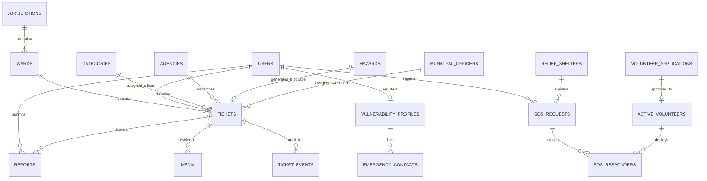

# JanRakshak — Database Models Design, Schema Architecture & Relationship Plan

| Attribute | Specification Details |
|:---|:---|
| **System** | **JanRakshak — Dual-Mode Civic & Disaster Management Platform** |
| **Database Engine** | **PostgreSQL 16 + PostGIS 3.4 Spatial Extension** |
| **ORM / Query Layer** | **SQLAlchemy 2.0 (Async) + GeoAlchemy2** |
| **Spatial Reference System** | **EPSG:4326 (WGS 84)** with `GEOGRAPHY(Point, 4326)` & `GEOMETRY(MultiPolygon, 4326)` |
| **Indexing Strategy** | **GiST Spatial Indexes** (`ST_DWithin`, `ST_Contains`) + B-Tree on foreign keys & enum filters |
| **Document Version** | `1.0.0` |
| **Date** | November 5, 2026 |

---

## 1. Executive Summary & Architectural Overview

The JanRakshak database architecture is purposefully engineered to operate under two distinct modes:
1. **Civic Normal Mode:** Efficient management of municipal infrastructure defects (potholes, drainage blocks, streetlight outages) with **PostGIS 50-meter spatial deduplication (`ST_DWithin`)**, automated ward routing, and strict SLA tracking.
2. **Disaster Emergency Mode:** Rapid life-safety coordination during natural calamities (e.g. Cyclone Michaung / Montha Category 3) featuring **vulnerable elder registries**, **proximity-based community volunteer dispatch (<500m)**, **NDRF tactical boat routing**, **cyclone relief shelter logistics**, and **real-time hazard polygon detour exclusion zones**.



---

## 2. Domain Decomposition (22 Cohesive Tables)

The schema is partitioned into four interconnected domains:

### Domain 1: Identity, Wards & Municipal Administration
| Table Name | Primary Purpose | Key Foreign Keys | Spatial Column |
|:---|:---|:---|:---|
| `users` | Unified authentication & identity for all personas (`CITIZEN`, `GVMC_ADMIN`, `NDRF_ADMIN`, `FIELD_WORKER`). | None | `last_location` (Point) |
| `jurisdictions` | Municipal entities (e.g. GVMC, NHAI AP, VMC) and their overall bounding boundary. | None | `boundary` (MultiPolygon) |
| `wards` | Administrative wards (e.g. Zone 2 Ward 14 Madhurawada) with precise boundary polygons for point-in-polygon routing. | `jurisdiction_id` | `boundary` (MultiPolygon) |
| `municipal_officers` | Ward engineers & sanitation inspectors with department, workload count, and shift status. | `user_id`, `ward_id` | None |

### Domain 2: Civic Governance & 50m Spatial Deduplication
| Table Name | Primary Purpose | Key Foreign Keys | Spatial Column |
|:---|:---|:---|:---|
| `agencies` | Departments handling works (GVMC Civil, APEPDCL Electrical, NDRF 10th Bn). | None | None |
| `categories` | Defect classifications (Potholes, Drainage, Trees, Power Lines, SOS). | `default_agency_id` | None |
| `sla_policies` | Mode-adaptive resolution targets (e.g. Pothole: Normal 48h vs. Disaster 6h). | `category_id` | None |
| `tickets` | Master aggregated work orders deduplicated within 50 meters. | `category_id`, `ward_id`, `assigned_agency_id`, `assigned_officer_id` | `location` (Point) |
| `reports` | Raw citizen complaints clustered into master tickets via PostGIS `ST_DWithin(50m)`. | `ticket_id`, `user_id` | `reported_location` (Point) |
| `media` | Before & After photographic evidence with GPS verification tags. | `ticket_id`, `report_id`, `uploaded_by` | `captured_location` (Point) |
| `ticket_events` | Immutable state-machine audit trail for verification and stage changes. | `ticket_id`, `actor_id` | None |
| `ticket_votes` | Citizen upvotes and crowd verification of completed works. | `ticket_id`, `user_id` | None |
| `field_worker_checkins` | GPS-verified contractor clock-ins within 50m of defect site before work start. | `ticket_id`, `worker_id` | `checkin_location` (Point) |

### Domain 3: Disaster Management & Tactical Life-Safety
| Table Name | Primary Purpose | Key Foreign Keys | Spatial Column |
|:---|:---|:---|:---|
| `vulnerability_profiles` | Pre-registered seniors, bedridden citizens, floor level, and oxygen needs. | `user_id` | None (inherits user point) |
| `emergency_contacts` | Next-of-kin contact chain for automated SMS during power outages. | `elder_id` | None |
| `sos_requests` | Emergency distress signals initiated via voice, 1-tap, or 2G SMS. | `user_id`, `ticket_id`, `assigned_rescue_team_id` | `live_location` (Point) |
| `sos_responders` | Real-time tracking of community volunteers en route to senior citizen homes. | `sos_request_id`, `volunteer_id` | None |
| `rescue_teams` | Official NDRF & SDRF squads, motorized boats, crane cutters, and helis. | `agency_id` | `current_location` (Point) |
| `relief_shelters` | Cyclone shelters with occupancy, generator fuel, potable water, and medical kits. | `ward_id` | `location` (Point) |
| `hazards` | Active road waterlogging, snapped 11kV wires, and fallen tree exclusion polygons. | `ticket_id` | `polygon` (Polygon) |
| `alerts` | IMD cyclone alerts and coastal storm surge broadcast polygons. | None | `affected_area` (MultiPolygon) |

### Domain 4: Civilian Volunteer Corps & Community Mobilization (New RBAC Domain)
| Table Name | Primary Purpose | Key Foreign Keys | Spatial Column |
|:---|:---|:---|:---|
| `volunteer_applications` | Public applications submitted via Disaster Portal awaiting NDRF vetting. | `user_id`, `reviewed_by` | None |
| `active_volunteers` | Approved or directly enrolled responders with equipment, skills, and status. | `application_id`, `user_id`, `ward_id`, `assigned_incident_id` | `location` (Point) |
| `volunteer_deployments` | Historical assignment logs linking volunteers to SOS emergencies & shelters. | `volunteer_id`, `sos_request_id`, `shelter_id` | None |

---

## 3. Detailed Entity Relationship Specifications

### 3.1 Relationships & Cardinality Matrix

```
1. jurisdictions (1) ────< (N) wards
2. wards (1) ───────────< (N) tickets
3. users (1) ───────────< (N) reports (Citizen submissions)
4. tickets (1) ─────────< (N) reports (50m Deduplication Clustering)
5. tickets (1) ─────────< (N) media (Before & After photos)
6. tickets (1) ─────────< (N) ticket_events (Audit history)
7. tickets (1) ─────────< (N) field_worker_checkins (Contractor GPS checkins)
8. municipal_officers (1) < (N) tickets (Assigned engineering workload)
9. categories (1) ──────< (N) tickets
10. categories (1) ─────< (N) sla_policies
11. users (1) ──────────| (1) vulnerability_profiles
12. vulnerability_profiles (1) < (N) emergency_contacts
13. users (1) ──────────< (N) sos_requests
14. sos_requests (1) ───< (N) sos_responders
15. volunteer_applications (1) ──| (1) active_volunteers (Approval transition)
16. active_volunteers (1) ─< (N) sos_responders (Dispatch assignments)
17. tickets (1) ────────| (1) hazards (Roadblocks generated from defects)
18. agencies (1) ───────< (N) rescue_teams
```

---

## 4. PostGIS Spatial Operations & Indexing Strategy

### 4.1 50m Spatial Deduplication Query (`ST_DWithin`)
When a citizen reports a pothole at `(:lat, :lon)`:
```sql
SELECT t.id, t.ticket_number, t.category_id, t.location,
       ST_Distance(t.location, ST_SetSRID(ST_MakePoint(:lon, :lat), 4326)::geography) AS distance_meters
FROM tickets t
WHERE t.category_id = :category_id
  AND t.stage NOT IN ('COMPLETED', 'CANT_RESOLVE')
  AND ST_DWithin(
        t.location,
        ST_SetSRID(ST_MakePoint(:lon, :lat), 4326)::geography,
        50.0  -- 50-meter deduplication threshold
      )
ORDER BY distance_meters ASC
LIMIT 1;
```
* If a record is returned $\rightarrow$ Link to existing `ticket_id`, increment `merged_count`, append to `reports` table.
* If no record is returned $\rightarrow$ Insert new master ticket in `tickets` table.

### 4.2 Point-in-Polygon Administrative Ward Router (`ST_Contains`)
Automatically assign municipal jurisdiction and ward engineer without manual clerical triage:
```sql
SELECT w.id AS ward_id, w.ward_number, w.zone_name, w.ward_engineer_name, w.jurisdiction_id
FROM wards w
WHERE ST_Contains(
        w.boundary,
        ST_SetSRID(ST_MakePoint(:lon, :lat), 4326)
      )
LIMIT 1;
```

### 4.3 Volunteer <500m Proximity Search (`ST_DWithin`)
When an elder triggers an SOS panic event:
```sql
SELECT v.id, v.name, v.phone, v.role, v.equipment,
       ST_Distance(v.location, :sos_location) AS distance_meters
FROM active_volunteers v
WHERE v.status = 'Available'
  AND v.is_verified_by_ndrf = TRUE
  AND ST_DWithin(v.location, :sos_location, 500.0) -- 500m radius
ORDER BY distance_meters ASC
LIMIT 5;
```

---

## 5. Implementation Roadmap for Database Tier

1. **Step 1:** Create `docker-compose.yml` for local PostgreSQL 16 + PostGIS 3.4 instance.
2. **Step 2:** Write complete DDL schema script `backend/database/schema.sql` with tables, spatial indexes, check constraints, and Visakhapatnam seed data.
3. **Step 3:** Implement modern SQLAlchemy 2.0 Async ORM models in `backend/app/models/`.
4. **Step 4:** Implement Pydantic v2 domain schemas for request/response validation in `backend/app/schemas/`.
5. **Step 5:** Write unit tests verifying spatial deduplication queries and relationship cascades.

